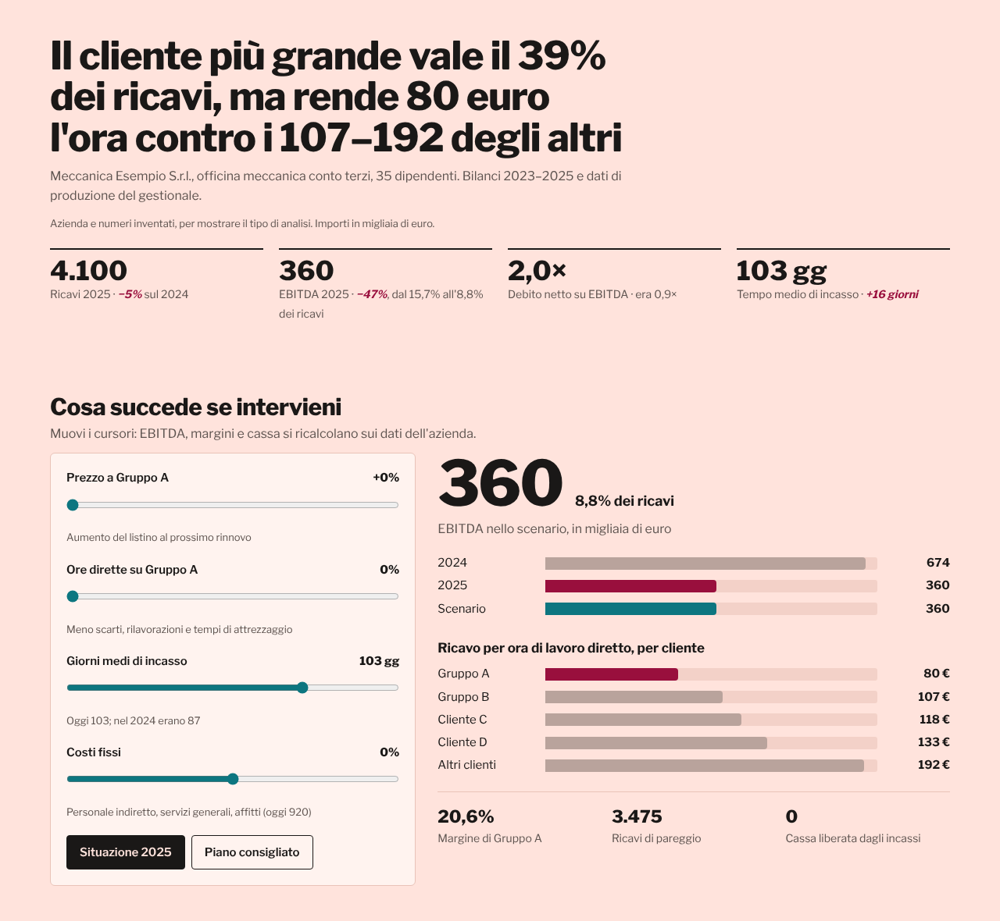

# Cruscotto di marginalità per PMI manifatturiere

**[Apri il cruscotto](https://andrea-milaneschi.github.io/cruscotto-marginalita-pmi/)**

Esempio interattivo dell'analisi che realizzo per le piccole e medie imprese manifatturiere: margini per cliente, ponte dell'EBITDA, andamento triennale e un simulatore che ricalcola i risultati al variare di prezzi, ore, incassi e costi fissi.

## Il caso

Pelletteria Esempio S.r.l., terzista di borse per marchi del lusso con 35 dipendenti. Azienda e numeri sono inventati, ma costruiti con proporzioni realistiche per il settore.

Nel 2025 i ricavi calano del 5% e l'EBITDA quasi si dimezza, da 674 a 360 mila euro. L'analisi per cliente mostra il motivo: il cliente principale vale il 39% dei ricavi ma assorbe il 49% delle ore di produzione, e rende 80 euro per ora di lavoro diretto contro i 107–192 euro degli altri clienti.

## Cosa contiene

| Sezione | Domanda a cui risponde |
| --- | --- |
| Indicatori chiave | Come è andato l'anno: ricavi, EBITDA, debito netto, giorni di incasso |
| Simulatore | Cosa succede all'EBITDA se cambio prezzo, ore, tempi di incasso o costi fissi |
| Ponte dell'EBITDA | Quali voci spiegano il calo tra un anno e l'altro |
| Andamento 2023–2025 | Ricavi e margine a confronto |
| Marginalità per cliente | Quota di ricavi, quota di ore, margine e composizione dei costi per cliente |
| Conto economico riclassificato | Il bilancio letto a valore aggiunto |

## Metodo

- Conto economico riclassificato a valore aggiunto; stato patrimoniale finanziario con capitale circolante e posizione finanziaria netta.
- Costo diretto per cliente: materiali, lavorazioni esterne e ore di lavoro a costo pieno orario.
- Margine di contribuzione, punto di pareggio e margine di sicurezza.
- Nel lavoro reale i dati arrivano dal bilancio e da un'estrazione del gestionale (fatturato per cliente e articolo, ore per commessa, consumi).

## Tecnologia

Una sola pagina HTML, senza dipendenze esterne oltre al font. Grafici in SVG disegnati a misura dello schermo, leggibili da telefono, con tema chiaro e scuro.

## Contatti

Andrea Milaneschi · Controllo di gestione e analisi dei dati per PMI manifatturiere
andreamilaneschi95@gmail.com · [LinkedIn](https://it.linkedin.com/in/andrea-milaneschi-a5abab196)

Sito: [andrea-milaneschi.github.io](https://andrea-milaneschi.github.io/)

Professione non organizzata in ordini o collegi ai sensi della Legge 14 gennaio 2013, n. 4. Non svolgo attività riservate agli iscritti in albi: revisione e attestazioni sui bilanci, adempimenti fiscali e del lavoro, mediazione creditizia.
